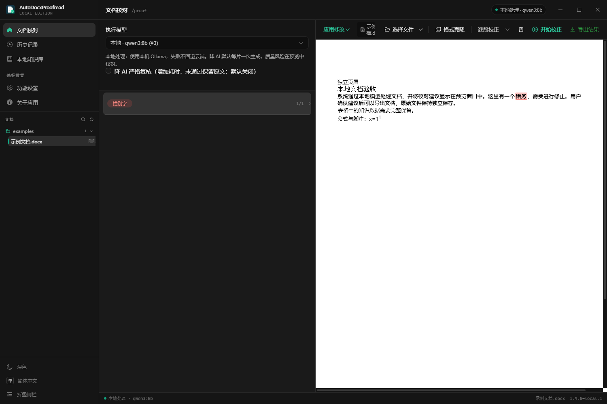
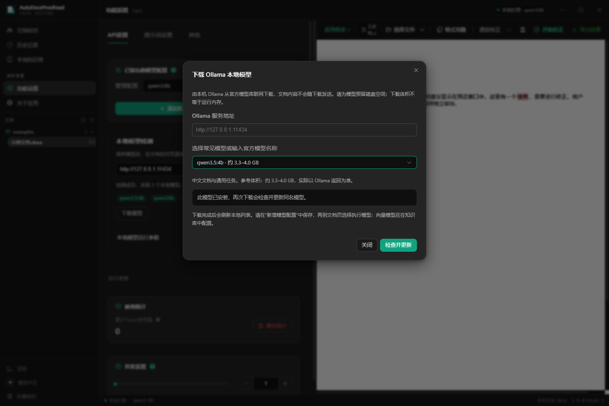
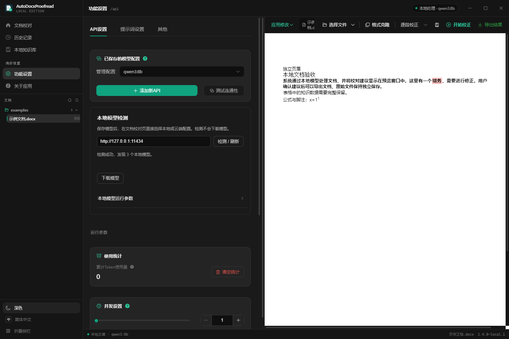
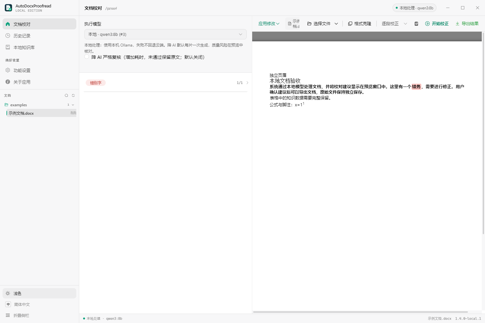
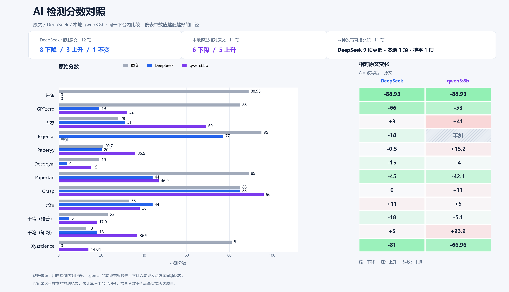
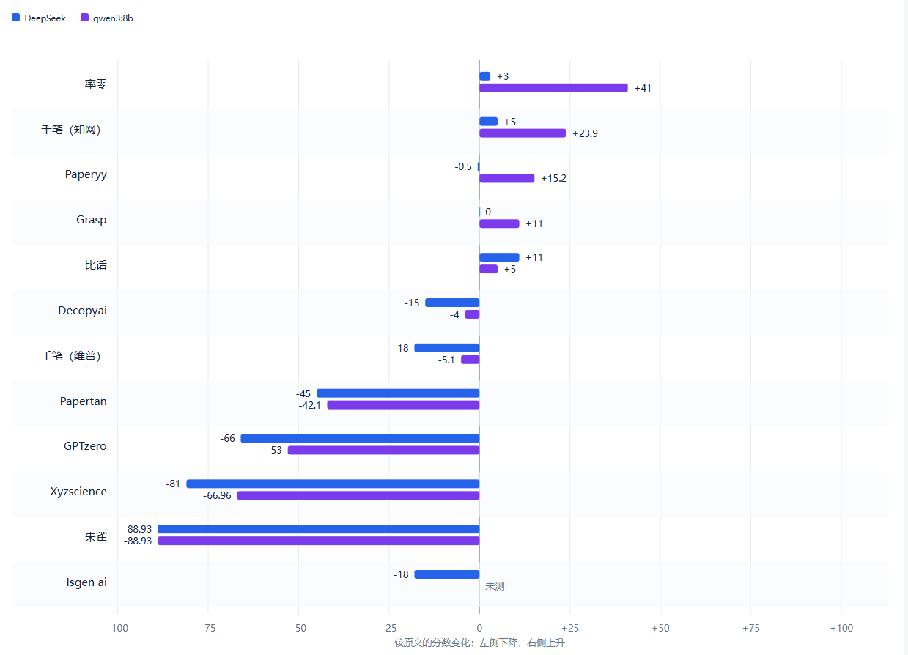

# AutoDocxProofread Local Edition

面向个人使用的 Windows 文档工作站，支持 Word 智能校对、文本润色、改写、修改预览和 DOCX 导出。可以使用 Ollama 本地模型，也可以切换到自己保存的云端模型。

**本项目基于 [CZ600/AutoDocxProofread](https://github.com/CZ600/AutoDocxProofread) 公开源码二次开发，参考基线为官方 v1.3.0（166b6ce）。原作者为 CZ600，原项目采用 MIT 许可证。** Word 校对、降 AI 提示方案、文档预览、导出、格式克隆和知识库等基础能力来自原项目；本仓库保留原作者署名和 [LICENSE](LICENSE)，新增内容见下表。

当前桌面版：**1.4.0-local.1**。这是独立维护的个人版本。源码与安装包不包含 API Key、个人数据库、文档、Ollama 程序或模型权重。

> 界面截图使用独立测试配置、虚构示例文档和模拟模型响应生成，展示实际界面，不代表真实模型的改写效果。

## 相对原版的修改

| 部分 | 本版修改 |
| --- | --- |
| 本地模型 | 接入 Ollama，支持检测、刷新、手动输入、流式生成、取消和超时处理 |
| 模型下载 | 在程序内选择常见模型或输入官方模型名称，查看进度、取消、重试，完成后自动刷新列表 |
| 模型切换 | 设置页保存配置，文档页直接选择本地或云端执行模型 |
| 长文处理 | 根据上下文、提示词和输出预留拆分本地任务；分片失败保留原文并展示原因 |
| 改写与复核 | 保留原版提示方案；额外语义复核按需开启，质量风险供人工核对 |
| 文档工作区 | 侧栏按文件夹展示打开过的文档，支持搜索、恢复最近结果、定位文件和打开导出文件 |
| 界面 | 调整侧栏、顶栏、状态栏及深浅色主题，保留 Word 预览和建议操作 |
| 数据与隐私 | 使用独立应用标识和数据目录；本地任务失败不自动回退云端 |
| Windows 交付 | 提供独立安装包，复用 SQLite 与 sqlite-vec，并保留第三方许可证声明 |

## 下载与安装

打开 [Releases](https://github.com/dongbingyu2-cpu/AutoDocxProofread-LocalEdition/releases)，下载 Windows x64 安装包：

**AutoDocxProofread-LocalEdition-Setup.exe**

运行安装向导后启动程序。使用安装版无需安装 Node.js；安装包未做代码签名。Ollama 和模型不包含在安装包内，需要另行准备。

原项目和本版使用不同的应用标识，可以并存。升级本地版前建议先备份本版数据；同一用户下的本版源码启动方式和安装版默认共用数据目录。

## 使用教程

### 1. 准备模型

**使用本地模型：**

1. 从 [Ollama 官网](https://ollama.com/download) 安装并启动 Ollama。
2. 打开程序的 **功能设置 → API 设置 → 本地模型检测**，默认地址是 http://127.0.0.1:11434。
3. 点击“检测 / 刷新”。如果还没有模型，点击“下载模型”，选择模型或输入完整名称，再点击“开始下载”。
4. 下载完成后，在“添加新 API”中选择 Ollama，选择模型并保存；本地配置无需 API Key。

下载进度按当前文件层显示；切换页面后仍可继续查看。模型较大时请预留磁盘和运行内存，参考下载体积不等于内存需求。向量模型用于知识库，不能作为文档改写模型。

**使用云端模型：**

在“添加新 API”中选择服务商，填写自己的 API 地址、API Key 和准确的模型名称，测试连接后保存。密钥只在本机配置中保存，提交 Issue 或截图时请遮住密钥。云端任务会把所需文本发送到你选择的服务商。

### 2. 导入 Word 并选择执行模型

1. 在侧栏进入 **文档校对**。
2. 在左侧“执行模型”中选择已保存的本地或云端配置。
3. 点击右上方“选择文件”，打开 DOCX，右侧会显示文档预览。
4. 选择校对模式，再点击“开始校正”。当前支持 DOCX，不直接支持旧式 DOC。

设置页用于管理模型配置，文档页的执行模型决定本次任务实际调用哪个模型。任务进行中会锁定选择。

### 3. 核对建议并导出

1. 查看左侧的原文、建议、原因及质量提示，点击条目可定位预览。
2. 按需应用、编辑、忽略或撤销建议，也可以批量应用。
3. 确认后点击“导出结果”，选择输出位置，生成 DOCX。
4. 使用 Word 打开导出文件，核对事实、专业术语、数字以及排版。文档预览是浏览器还原，复杂排版可能与 Word 不同。

校对与改写结果都需要人工检查。程序不会保证事实永远正确，也不保证能够通过任何 AIGC 检测平台。

### 4. 运行参数与知识库

在 **功能设置 → API 设置 → 本地模型运行参数** 中调整上下文、最大输出、并发和超时。默认上下文 16384、输出上限 8192、并发 1。上下文要同时容纳提示词、输入与输出；整篇长文会分片处理，不要求一次放入模型。

知识库需要另行保存可用的 Embedding 配置。聊天模型不一定支持向量接口；更换向量模型可能改变维度，建议新建知识库重新导入，不覆盖旧库。

深浅色主题可以在侧栏底部切换：

详细步骤见 [使用手册](docs/USAGE.md)，开发和打包见 [构建说明](docs/BUILD.md)。

## 一份样本文档的检测对比

以下图片由维护者提供，比较同一份样本文档的原文、DeepSeek 改写和本地 qwen3:8b 改写结果。它们是这份样本的检测平台分数记录，不是对检测准确性或其他文档效果的证明。

- 变化值为“改写后分数 − 原文分数”，负值表示下降，正值表示上升。
- Isgen ai 的本地结果缺失，按“未测”处理，不作为 0 分。
- 本地模型在部分平台降分、部分平台升分，各平台的分数不能当作统一尺度。
- 没有计算跨平台平均分，也不承诺对其他模型、文档或检测版本复现相同结果。

## 开发与测试

技术栈：Electron 30、Vue 3、TypeScript、Vite、Element Plus、SQLite 和 sqlite-vec；Word 预览使用 docx-preview。

需要 Git、Node.js 24 和 npm。获取本仓库后运行：

~~~powershell
npm ci
npm run dev
~~~

构建与验证：

~~~powershell
npm run typecheck
npm test
npm run build
npm run build:win
~~~

Windows 安装包生成在 release/。运行环境、测试范围和注意事项见 [构建说明](docs/BUILD.md) 与 [测试说明](docs/TESTING.md)。自动测试中包含模拟服务，不能将其当作真实模型效果测试。

本次发布验证：干净源码自动测试 **251 通过、28 跳过**，正式 EXE 的模拟桌面检查 **23 项通过**，模型下载流程 **10 项通过**；类型检查、源码构建及 Windows 安装包构建通过。本轮没有下载新的真实模型或重新测试真实模型效果。

## 数据与隐私

- 本版数据默认保存在用户应用数据目录中的 AutoDocxProofread-LocalEdition 子目录，具体位置可在“关于应用 → 数据与隐私”查看。
- 本地模式使用本机 Ollama，不自动回退云端；本地任务的辅助模型也受本地策略约束。
- 密钥由 Electron safeStorage 在可用时加密保存；无法使用系统加密时会有降级行为，详见 [隐私说明](docs/PRIVACY.md)。
- 本仓库不接收真实文档、数据库、登录会话或密钥。截图与比较图经过单独检查后纳入。
- 此次首次公开采用当前源码快照，不上传本机旧 Git 历史与私人验收记录。

当前发布的是 Windows 桌面版。局域网网页和 HTTP 工作站方案处于规划阶段，本轮暂缓开发。

## 原作与致谢

- 原项目及作者：[CZ600/AutoDocxProofread](https://github.com/CZ600/AutoDocxProofread)。
- 原作保留的降 AI 提示方案参考：Linux.do 用户 Chisaki 的 [原帖](https://linux.do/t/topic/620470)。
- 原项目部分基础代码参考 [night-peiqi/electron-vue3-typescript-template](https://github.com/night-peiqi/electron-vue3-typescript-template)。
- 第三方组件声明：[THIRD_PARTY_NOTICES.txt](docs/THIRD_PARTY_NOTICES.txt)。

遵循 [MIT 许可证](LICENSE)。请保留原作者版权与许可声明。
