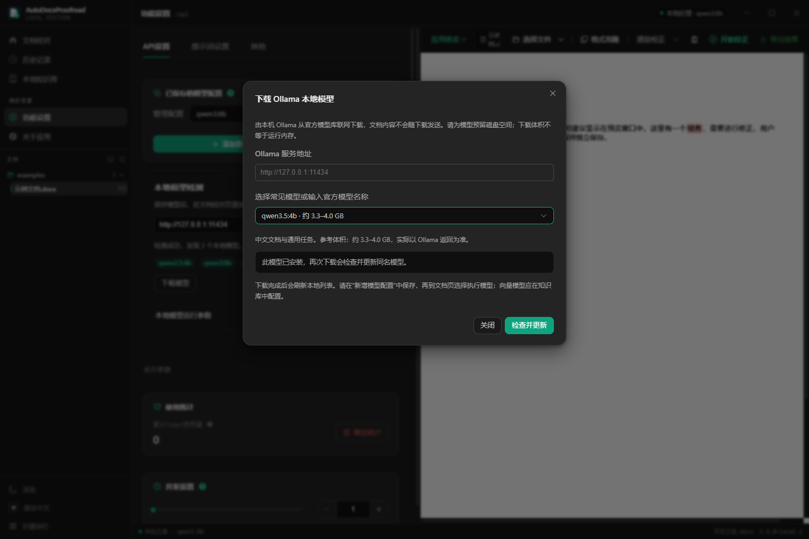

# 程序内下载 Ollama 模型

2026-11-06 新增，仅开发用户修改后的新版。旧版归档保持冻结。

## 使用

1. 启动本机 Ollama，打开桌面“AutoDocxProofread 本地版”。
2. 进入 **功能设置 → API 设置 → 本地模型检测 → 下载模型**。
3. 选择常见模型，或输入官方模型库中的名称，如 qwen3.5:4b。
4. 点击“开始下载”，查看状态、当前文件层的百分比和字节数。关闭下载弹窗或切换页面仍可继续下载，也可随时取消。
5. 完成后本地模型列表自动刷新。在“添加新 API”中选择 Ollama 并保存模型配置，然后在文档页选择执行模型。向量模型则用于知识库 Embedding 配置。

已安装的模型会提示“检查并更新”，再次下载可能更新同名模型。参考体积来自官方模型库，实际体积可能随标签更新改变；下载体积不等于运行内存。下载不会自动调整上下文、切换执行模型、修改提示词或变更已有知识库绑定。

## 可选入口

提供 qwen3.5:2b/4b、qwen3:1.7b/4b/8b、qwen2.5:7b、deepseek-r1:8b 和 embeddinggemma:300m。最后一个是向量模型，不能用于文档改写。模型效果应按实际文档核对，不保证检测平台分数。

官方目录：[Qwen3.5](https://ollama.com/library/qwen3.5)、[Qwen3](https://ollama.com/library/qwen3)、[Qwen2.5 7B](https://ollama.com/library/qwen2.5:7b)、[DeepSeek-R1 8B](https://ollama.com/library/deepseek-r1:8b)、[EmbeddingGemma](https://ollama.com/library/embeddinggemma)。

## 行为与边界

- 下载由本机 Ollama 的官方 POST /api/pull 执行，模型文件由 Ollama 管理。程序和安装包不携带模型权重，也不安装或升级 Ollama。
- 打开设置、刷新检测、普通文档处理都不会触发下载；只有点击下载按钮才发送请求。
- 服务地址限定回环地址，默认 http://127.0.0.1:11434。可使用本机其他端口或 /v1 地址，下载时归一化到服务根地址。
- 仅支持 Ollama 官方模型库名称及其命名空间，不接收 URL、第三方注册表地址、命令或云端模型标签。
- 下载请求仅包含模型名称和流式标志，不包含文档、提示词、模型配置的 API Key。
- 主进程同时执行一个下载。状态在主进程保存，页面销毁时只移除订阅；退出所属窗口会中止请求。
- 取消或失败不删除既有模型及缓存。再次点击下载由 Ollama 复用已下载的内容。若另一个客户端正在拉取同一模型，Ollama 可能继续为那个客户端下载，本程序不声称能终止其他客户端的任务。
- 两分钟没有收到响应数据时报告超时，正常持续下载没有固定总时长限制。缺失成功终态、服务错误、格式错误及连接中断都不能显示为成功。
- Ollama 按文件层提供进度，百分比可能在换层时重新开始；校验和写入阶段显示状态，不虚构整个模型的总进度。

接口依据：[Ollama Pull API](https://docs.ollama.com/api/pull)、[官方仓库完整接口说明](https://github.com/ollama/ollama/blob/main/docs/api.md#pull-a-model)。官方库模型的许可证、资源要求和 Ollama 最低版本仍以各模型页面为准。

## 实现文件

| 文件 | 职责 |
| --- | --- |
| src/shared/ollamaDownload.ts | 下载状态与常见模型目录 |
| src/main/ollamaDownload.ts | 名称验证、原生流解析、超时与中止 |
| src/main/ipc/ollamaDownloadHandlers.ts | 单任务、归属检查、事件节流及终态 |
| src/main/ipc/localEditionHandlers.ts | 注册下载通道 |
| src/main/preload.ts、src/renderer/electron.d.ts | 白名单接口和类型 |
| src/renderer/components/api/OllamaModelDownload.vue | 下载弹窗、状态展示和页面订阅恢复 |
| src/renderer/components/api/LocalEditionPanel.vue | 下载入口、自动刷新及检测响应顺序保护 |
| tests/ollamaDownload*.test.ts | 传输和任务生命周期测试 |
| scripts/model-download-smoke.cjs | 独立配置下的 Electron 窗口验证 |

## 验证

- 全量自动回归：**251 通过、28 跳过、0 失败**，依据逐条断言状态计数；Vitest JSON 顶层汇总误将跳过项计入通过项，未采用该汇总数字。
- 本功能新增 **16 项**传输/IPC 测试，包含流分块、缺失终态、取消、超时、错误、重试、窗口归属和最后进度不丢失。
- 真实 Electron 窗口 + 独立测试配置 + 回环模拟服务：**10 项通过**，覆盖按钮、选择和手动输入、进度、切页恢复、自动刷新、取消和失败重试。测试未自动保存或切换模型。
- 类型检查和新版源码构建通过；已检查下载窗口截图。
- 本轮没有下载真实模型权重，没有验证外部模型仓库到本机的真实大文件传输，也没有重新生成 Windows 安装包。桌面源码快捷方式读取已更新的 out/。

最初全量回归受到本机模拟接口访问限制与旧测试数据库残留影响；在允许本机测试连接、暂存并恢复测试专用夹具后重跑通过。实际用户数据库未参与测试。

测试记录位于 .validation/model-download-regression-20261106.json 和 .validation/model-download-*/report.json；测试运行目录及数据库不纳入 Git。
